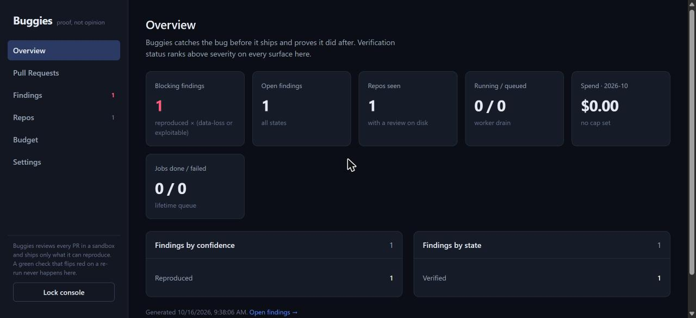

# Buggies

**Catches the bug before it ships — and proves it did after.**

Buggies reviews every pull request unattended, hunts for real defects in the code
a change can reach, and **only comments once it has reproduced the bug in a
sandbox — attaching the failing test that proves it**. No reproduction, no
comment. The first thing a developer sees is a red test on the exact line, not an
opinion they have to adjudicate.

It runs the whole review itself as a GitHub App — checkout, isolation, model
calls, proof, posting — so there is nothing to wire into CI. Untrusted fork code
runs under gVisor with repository secrets stripped from the model; **Node and
Python** are supported today; the model cascade runs **on-device by default** (the
`claude` CLI, no `ANTHROPIC_API_KEY`, no API billing). A built-in admin dashboard
shows every job, finding, and dollar spent.

It is a thin, opinionated shell over the shared [`kernel`](../README.md) engine,
tuned to be **quiet**: high precision, low noise, predictable per-seat cost.

Start with [VISION.md](VISION.md), then [ARCHITECTURE.md](ARCHITECTURE.md),
[STACK.md](STACK.md), [USAGE.md](USAGE.md), [OPERATING.md](OPERATING.md),
[ROADMAP.md](ROADMAP.md).

## See it work

Two surfaces, both real. Below is an actual review of a seeded bug
(`gold-tier-discount`): a head commit capitalizes `'gold'`, so gold-tier
customers silently stop getting their 20% discount. Buggies reproduced it in the
sandbox before saying a word.

**What it posts on the pull request** — claim, severity badge, the failing test
it reproduced, and the fix:

> **applyDiscount no longer applies the 20% discount to users whose tier is 'gold', so they are charged full price.**
>
> `Correctness · Reproduced × Data-loss` · **blocking**
>
> <details><summary>Failing test — reproduced 2/2 runs in the sandbox</summary>
>
> ```js
> import { test } from 'node:test';
> import assert from 'node:assert/strict';
> import { applyDiscount } from '../discount.js';
>
> test('applyDiscount gives gold-tier users 20% off', () => {
>   assert.equal(applyDiscount({ tier: 'gold' }, 100), 80);
> });
> ```
> </details>
>
> <details><summary>Suggested fix</summary>
>
> ```diff
>  export function applyDiscount(user, price) {
> -  if (user.tier === 'Gold') return price * 0.8;
> +  if (user.tier === 'gold') return price * 0.8;
>    return price;
>  }
> ```
> </details>
>
> _Reproduced in sandbox (buggies/sandbox-node:22, failed)._

**The admin dashboard** — every job, finding, and dollar spent, on a
loopback-only mux (`BUGGIES_ADMIN_TOKEN`):



Run it yourself against any data root with
[`deploy/capture-dashboard.sh`](deploy/capture-dashboard.sh); stand up a public,
click-through demo on GitHub with [`deploy/DEMO.md`](deploy/DEMO.md).

**Try it live — three real pull requests, reviewed by the bot under gVisor:**

| Pull request | The change | What Buggies did |
|---|---|---|
| [buggies-demo-gold-tier-discount #1](https://github.com/JoshBlazer/buggies-demo-gold-tier-discount/pull/1) | capitalizes `'gold'`, dropping gold-tier discounts | ❌ **blocking** — reproduced the data-loss bug |
| [buggies-demo-page-drops-last #1](https://github.com/JoshBlazer/buggies-demo-page-drops-last/pull/1) | pagination slice drops each page's last record | ❌ **blocking** — reproduced the dropped records |
| [buggies-demo-clean-refactor #1](https://github.com/JoshBlazer/buggies-demo-clean-refactor/pull/1) | rewrites a `for`-loop as `reduce`, no behavior change | ✅ **clean** — no finding, no noise |

No account or setup needed — open any PR and read the `buggies` check and review
comment. The clean one is the point as much as the bugs: the reviewer is
calibrated, not trigger-happy.

## How it works

```
diff ──► scope (blast radius)     which code can this change actually affect?
     ──► scaffold (eslint, tsc)   cheap deterministic pre-filters
     ──► triad                    propose ─► attack ─► prove
     ──► verify (sandbox)         reproduce the bug on real code, twice
     ──► store                    stable ID, encrypted, minimal retention
     ──► post                     PR review comment + CI check run
```

A finding that can't be reproduced by the sandbox is never stored; a dismissed
finding stays quiet on re-run; the same bug always gets the same stable ID. The
CI check fails **only** when a reproduced finding is data-loss or exploitable —
clean changes get a green "no findings" check, never noise.

The model cascade escalates only when it pays off: a cheap pass filters
candidates, a mid pass confirms, a frontier pass proves the survivors
(**Haiku → Sonnet → Opus** aliases). By default the models run through on-device
Claude (the `claude` CLI) — no `ANTHROPIC_API_KEY` and no API billing; set
`BUGGIES_MODEL_BACKEND=anthropic` to use the API instead.

## Two ways to run

**One-shot** — review a single diff by its base/head commits (`buggies review`).

**Unattended** — `buggies serve` runs as a [GitHub App](OPERATING.md): a
`pull_request` webhook (HMAC-verified) lands in a SQLite queue (idempotent on
`repo@head_sha`), a worker mints an installation token, checks out the exact
head, reviews it, and posts a check run plus a review comment. Pull requests
from forks are treated as untrusted — their code runs with secret-bearing env
stripped, and the model never sees repository secrets. When the sandbox runtime
is unreachable the PR gets an honest "sandbox unavailable" check rather than
silence.

**Dashboard** — set `BUGGIES_ADMIN_TOKEN` and `serve` also mounts a React admin
dashboard (JSON API + SPA) on a separate loopback port: every job and its state,
each finding with its reproduction proof, per-repo spend against budget, and
live settings. It is bearer-token-gated and never shares the public webhook
listener.

## Layout

| path | owns |
|------|------|
| `cmd/buggies` | CLI: `review`, `index`, `radius`, `serve`, `mcp`, `version` |
| `internal/pipeline` | the left door: scope → triad → verify → store |
| `internal/unattended` | the serve worker: queue → review → post, with skip handling |
| `internal/api` + `web` | admin dashboard: bearer-gated JSON API and React/Vite SPA |
| `internal/queue` | SQLite job queue, idempotency, retries |
| `internal/integrations/github` | GitHub App: webhook, installation tokens, review + check-run posters |
| `internal/agents` | proposer / skeptic / prover — conservative, stop-early |
| `internal/claudecli` | on-device Claude backend (shells to the `claude` CLI) |
| `internal/policy` | model cascade policy, budgets, self-throttle thresholds |
| `internal/budget` | per-install spend cap |
| `internal/security` | fork isolation (secret-stripping env for untrusted code) |
| `internal/store` | Buggies' own finding store (encrypted, minimal retention) |
| `internal/scaffold` | deterministic pre-filters (eslint, tsc) |
| `internal/surfaces/{prcomment,checkrun}` | renders the PR comment and CI check |
| `cmd/buggies-eval` + `internal/eval` | precision/recall harness over the seeded-bug fixtures |
| `deploy` | self-hosted compose + WSL sandbox setup |
| `testdata` | seeded-bug fixture repos — the start of the eval corpus |

## Quickstart

Requires Go 1.26+, Docker + **gVisor (`runsc`)** in WSL2 Ubuntu, and the `claude`
CLI on PATH (or `BUGGIES_MODEL_BACKEND=anthropic` with `ANTHROPIC_API_KEY`).
Sandbox images are prebuilt; build them once from the kernel repo:

```sh
# one-time: build the sandbox images (from the kernel repo root)
make images            # buggies/sandbox-{node:22,python:3.13,egress}

# one-shot: review a diff — reproduces any finding before reporting it
BUGGIES_CLAUDE_BIN=claude ./bin/buggies review \
  --repo /path/to/target --name owner/repo \
  --base <base-sha> --head <head-sha>
```

Buggies **refuses to run untrusted code on runc**; install gVisor so the sandbox
runs under `runsc`. On a dev machine without it, `BUGGIES_ALLOW_RUNC=1` opts out
(never in production).

Run unattended (add `BUGGIES_ADMIN_TOKEN` to also serve the dashboard):

```sh
BUGGIES_WEBHOOK_SECRET=…  BUGGIES_GITHUB_APP_ID=…  BUGGIES_GITHUB_APP_KEY=/path/key.pem \
BUGGIES_CLAUDE_BIN=claude  BUGGIES_ADMIN_TOKEN=…  ./bin/buggies serve --addr :8080
```

See [OPERATING.md](OPERATING.md) for the full env (`BUGGIES_BUDGET_CENTS`,
`BUGGIES_GITHUB_HOST`, `BUGGIES_SKILLS`, …), the webhook wiring, and a sample
systemd unit.

## Status

**v1.0.0 — unattended review is live, and has caught a real bug.** On a live
GitHub pull request, the `serve` daemon reproduced a seeded correctness
regression (a short-flag match silently dropped) end-to-end under gVisor and
posted an inline review comment carrying the failing test — webhook → queue →
installation checkout → scope → triad → sandbox reproduction → check run +
comment, untouched by human hands. On the eval fixtures it reproduces the
seeded data-loss bugs and flags **nothing** on a behavior-preserving refactor.
The three [live demo PRs](#see-it-work) above are those runs, posted to public
repos and kept up so anyone can click through them.

M1–M12 complete: scaffold, gVisor sandbox (no network, read-only rootfs,
resource caps, registry-only egress proxy), the tree-sitter + SQLite code graph,
the triad (conservative agents, cascade proof, encrypted store, stable IDs), the
`serve` GitHub App, a Node + Python sandbox, and the admin dashboard.

## Local development

Two modules, one workspace. `go.work` (git-ignored) is just `use (. ..)` — the
`kernel` repo lives one directory up, so uncommitted kernel changes are picked up
during co-development. `go.mod` pins the kernel by tag (**`v1.31.0`**) and keeps a
`replace => ..`, so `GOWORK=off go build` resolves it from the working tree; drop
the replace (and set `GOPRIVATE=github.com/joshblazer`) to build against the
pinned tag from the private kernel repo. The sandbox runs in WSL2 Ubuntu
(Docker + gVisor); see [`deploy/wsl-setup.md`](deploy/wsl-setup.md).

## License

Private. All rights reserved.
